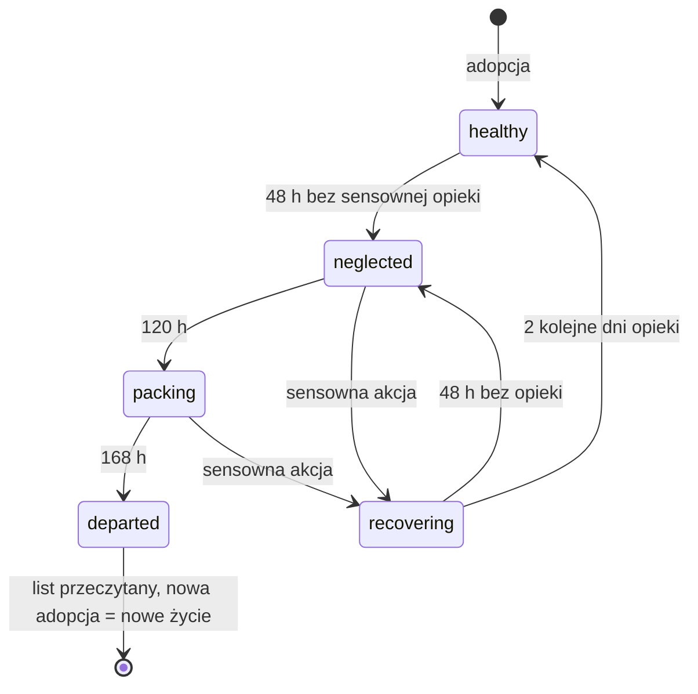
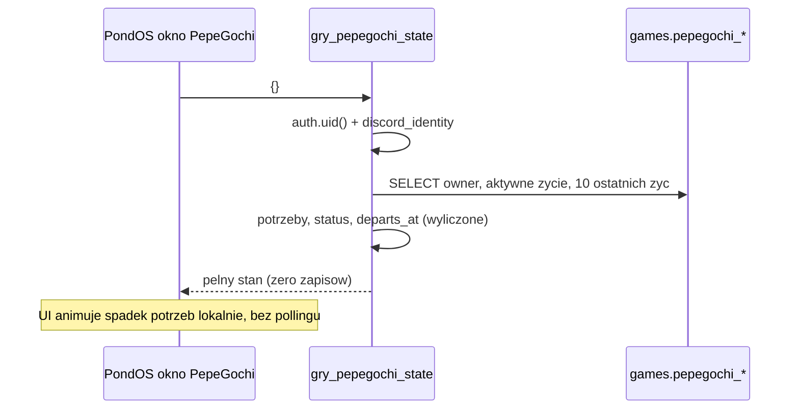
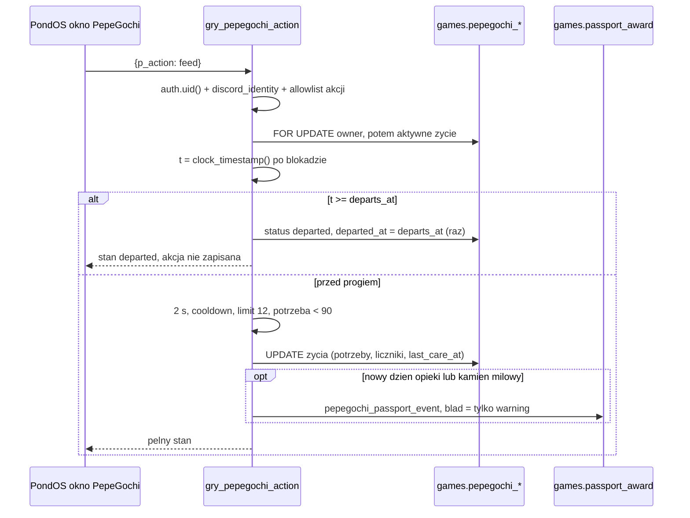
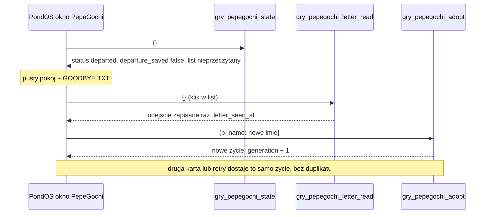
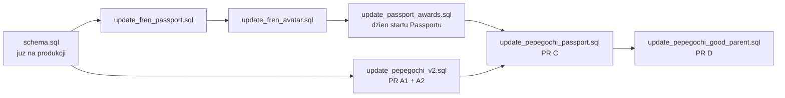

# PepeGochi 2.0 — przegląd backendu i plan techniczny

**Status:** raport design review (CLAUDE_HANDOFF.md, sekcja 3). Tylko dokument. Bez zmian w aplikacji, bez SQL na produkcji, bez publikacji.
**Data:** 2026-11-07.
**Podstawa:** `README.md`, `CLAUDE_HANDOFF.md`, `STORY_CONTENT.md` z PR #216; backend z PR #186 (`codex/pepegochi-secure-backend-v1`, commit `c26f2f7d`); `main` z Passportem z PR #212.
**Poza zakresem:** wygląd gry, postać, pokój, animacje (osobny etap z ChatGPT), realne wypłaty PEP, mnożnik 1,5×.

Wartości liczbowe w tym dokumencie (godziny, progi potrzeb, liczba dni) to **kandydaci do playtestu**, nie decyzje. Lista decyzji dla właściciela jest w sekcji 14.

---

## 0. Najważniejsze wnioski

1. **Fundament bezpieczeństwa v1 jest dobry i warto go zachować**: tożsamość tylko z `auth.uid()` + Discord, brak grantów do tabel, blokada wiersza, czas serwera po blokadzie, limity akcji, ułamkowy spadek potrzeb. Potwierdziłem to na prawdziwym PostgreSQL 17, także przy 12 równoległych połączeniach (sekcja 1).
2. **Model danych v1 nie pozwala na wyprowadzkę.** `games.pepegochi_pets` ma klucz `user_id`, więc jeden zwierzak na zawsze, bez historii, bez statusu i bez konsekwencji. Po 30 dniach nieobecności żaba ma wszystkie potrzeby 0 i dalej przyjmuje karmienie. Potrzebny jest nowy model: wiele kolejnych żyć, najwyżej jedno aktywne.
3. **v1 nie jest wdrożone, Passport też nie** (według PR #186, PR #212 i komentarza w `docs/meme/meme.js`). Jeśli to potwierdzisz, v2 może być czystym schematem zamiast migracji danych. Konwersję starych wierszy v1 i tak dodam jako zabezpieczenie.
4. **Bridge z #186 trzeba wyrzucić, a nie poprawiać.** Przyznaje `certified_fren` za 100 dni opieki, z pominięciem `games.passport_award()`. Test pokazał też, że błąd zapisu stempla cofa całą akcję opieki, a ponowne uruchomienie bazowego SQL po cichu wyłącza bridge.
5. **„Dzień opieki” w v1 nie mierzy opieki.** Kliknięcie Rest przy energii 100 zmienia tylko nastrój o +5, a i tak daje dzień opieki. Proponuję dwa liczniki: dzień opieki (wzrost żaby) i dobry dzień opieki (prestiżowe stemple).
6. **Wyprowadzkę da się zrobić bez crona i bez zapisu przy odczycie.** Moment odejścia wynika z zapisanych znaczników czasu (`ostatnia sensowna opieka + 168 h`), więc każde wywołanie liczy ten sam wynik. Zapis odejścia następuje raz, przy pierwszym wywołaniu zapisującym.
7. **Plan to 7 małych PR-ów przed wydaniem** (A1, A2, B1, B2, C, D, R). Pierwsze dwa to sam backend i testy na prawdziwym PostgreSQL.

---

## 1. Co sprawdziłem i jak

Wszystko lokalnie, w piaskownicy: jednorazowy PostgreSQL 17.11 (`embedded-postgres`) i PGlite. Żadne polecenie nie łączyło się z Supabase.

| Sprawdzenie | Wynik |
|---|---|
| `main`: `node --test tests/*.test.mjs` z prawdziwym PostgreSQL (`PASSPORT_PG_URL`) i PGlite (`YEET_PGLITE_MODULE`) | **92/92 pass**, 0 skip (w tym testy SQL Passportu, Avatar Makera, ankiet i YEET) |
| PR #186: `tests/pepegochi_backend.test.mjs` + `tests/pepegochi_postgres.integration.mjs` | **9/9 pass**. Test PGlite w opisie #186 był oznaczony jako niewykonany; tu przeszedł |
| PR #186 zainstalowany na `main` (schema + Passport + awards) i sprawdzony skryptem próbnym, 12 równoległych połączeń | wyniki niżej |

Wyniki skryptu próbnego dla v1 (skrypt jest tylko w piaskownicy; jego przypadki wchodzą do testów PR A1):

| Scenariusz | Wynik | Ocena |
|---|---|---|
| rola `anon` wywołuje `gry_pepegochi_state` | `permission denied` | OK |
| konto bez tożsamości / tylko e-mail → adopt | `Discord sign-in required` | OK |
| `authenticated`: UPDATE na tabeli, EXECUTE na `pepegochi_snapshot` i hooku | brak uprawnień | OK |
| 12 równoległych `adopt` jednego konta | 1 wiersz | OK |
| 12 równoległych `feed` | 1 przyjęty, `actions_today = 1` | OK |
| `gry_pepegochi_state()` w transakcji READ ONLY | działa (odczyt naprawdę nic nie zapisuje) | OK |
| `rest` przy energii 100 | przyjęty, **daje dzień opieki** | problem dla v2 |
| 30 dni nieobecności | potrzeby 0/0/0/0, brak pola statusu, `feed` przyjęty normalnie | brak konsekwencji |
| 100. dzień opieki z bridge | `certified_fren` przyznany z opisem „100 distinct days of signed-in PondOS activity” przy **0** dni w `passport_days` | konflikt |
| `games.passport_award(u, 'certified_fren')` | `Unknown passport stamp` (bridge omija jedyną ścieżkę przyznawania) | konflikt |
| błąd zapisu stempla w 100. dniu (wymuszony triggerem) | **cała akcja odrzucona**, `care_days` zostaje 99 | błąd |
| ponowne uruchomienie `update_pepegochi_v1.sql` po bridge | hook wraca do no-op, 100. dzień nie daje stempla | kruche |
| imiona `Żabka`, `Frеn` (cyrylickie „е”) | przyjęte | OK dla prywatnego imienia, do moderacji jeśli imię będzie publiczne |
| `a`, 19 znaków, znak zerowej szerokości, `<b>x</b>` | odrzucone | OK |

---

## 2. Obecny backend v1 (PR #186): co zostaje, co się zmienia

### Zachowuję bez zmian
- Wzorzec `public.gry_*` + `security definer` + `set search_path = ''` + `revoke all` / `grant execute to authenticated`.
- Tożsamość wyłącznie z `auth.uid()` i `games.discord_identity()`. Żadne RPC nie przyjmuje `user_id`, statystyk, czasu, liczników ani ID stempla.
- Tabele w prywatnym schemacie `games`, RLS włączone, zero grantów dla klienta.
- Blokada `for update`, a czas `clock_timestamp()` dopiero po blokadzie.
- Cztery akcje (`feed`, `clean`, `play`, `rest`), ich efekty, cooldowny 30/20/45/60 min, odstęp 2 s, limit 12 przyjętych akcji na dzień UTC.
- Potrzeby jako `numeric(7,4)`, spadek 20/15/18/10 na dobę, zaokrąglenie tylko w odpowiedzi dla UI.
- Etapy: tadpole 0–1 dni opieki, froglet 2–6, adult 7+ (zgodne ze stemplami `little_fren` i `grown_fren`).
- Brak crona, Realtime, heartbeatu i logu kliknięć.

### Zmieniam
| v1 | v2 | Powód |
|---|---|---|
| `pepegochi_pets`, PK `user_id` | `pepegochi_owners` (1 wiersz na konto) + `pepegochi_lives` (1 wiersz na życie, najwyżej 1 aktywne) | kolejne życia, historia |
| brak statusu | status pochodny od czasu: healthy / neglected / packing / departed, plus recovering | konsekwencje zaniedbania |
| każda przyjęta akcja = dzień opieki | liczy się tylko **sensowna** akcja (potrzeba docelowa < 90 przed akcją); akcja przy potrzebie ≥ 90 jest odrzucana bez zapisu | „Rest przy 100” nie jest opieką |
| jeden licznik `care_days` | `care_days` (wzrost) + `good_days` i seria dobrych dni (prestiż) | stemple 30/100 dni nie mogą być za samo kliknięcie |
| hook no-op nadpisywany przez bridge | hook tworzony tylko jeśli nie istnieje; wywołanie w `begin … exception when others then raise warning` | błąd stempla nie psuje gry; ponowne uruchomienie nie kasuje integracji |
| bridge `certified_fren` | usunięty; stemple PepeGochi tylko przez `games.passport_award()` | zasady Passportu |
| test PGlite | testy na prawdziwym PostgreSQL przez istniejący harness `PASSPORT_PG_URL` / `PASSPORT_PG_MODULE`, z wieloma połączeniami | spójność z resztą repo, test równoległości |

Uwaga o nazwach: w `schema.sql` istnieje już tabela `games.owners` (inna funkcja). Wszystkie nowe obiekty mają prefiks `pepegochi_`.

---

## 3. Konflikty z osiągnięciami

| # | Konflikt | Gdzie | Propozycja |
|---|---|---|---|
| K1 | Bridge #186 przyznaje `certified_fren` za 100 dni PepeGochi. Katalog i decyzje z 2026-11-06 mówią: 100 różnych dni aktywności w PondOS. | `update_pepegochi_passport_bridge.sql` | Nie przenosić bridge do v2. `certified_fren` zostaje `planned` i zarezerwowany. Jeśli kiedyś powstanie, to z `games.passport_days` w osobnym PR spoza PepeGochi. |
| K2 | Bridge wpisuje do `passport_badges` bezpośrednio, z pominięciem `games.passport_award()` (lista dozwolonych ID + kontrola Discord). | jw. | Każdy stempel PepeGochi przez `passport_award()`. |
| K3 | `passport_award()` ma zaszytą listę 19 ID. Stemple PepeGochi wymagają jej rozszerzenia. | `update_passport_awards.sql` | **Wariant 1** (jeśli plik nie jest jeszcze na produkcji): dopisać ID stempli PepeGochi w tym pliku i rozszerzyć test „każde dozwolone ID jest gdzieś przyznawane” na plik PepeGochi. **Wariant 2**: plik PepeGochi nadpisuje `passport_award()` pełną listą; wtedy ponowne uruchomienie pliku Passportu wyłącza stemple PepeGochi (ta sama pułapka co w #186), więc potrzebny test i adnotacja o kolejności. Rekomenduję wariant 1. |
| K4 | `good_parent`: w katalogu „Provide care on 30 distinct days”. README chce 30 dni **dobrej** opieki w jednym życiu. | `passport-catalog.json` | Jawna zmiana opisu w PR D, razem z wpisem w pliku decyzji. Bez cichej zmiany reguły. |
| K5 | `perfect_parent` („Complete a full month of good care”) nie różni się od nowego `good_parent`. | jw. | Zostaje `???`, dopóki nie zapadnie decyzja o wyzwaniu Fren Guardian (sekcja 10). Jeśli Guardian powstanie, to on jest `perfect_parent`. |
| K6 | Nagroda za 100 dni z jednym zwierzakiem nie ma ID. | — | Nowy stempel PepeGochi, roboczo `best_fren_forever` „Best Fren Forever”: 100 dobrych dni opieki w jednym życiu. Nazwa i reguła do decyzji. |
| K7 | „It's Not Me, It's You” nie może nagradzać zaniedbania ani przechodzić przez `gry_passport_discover(text)` (to API klient może wywołać sam). | — | Zapis w historii zwierzaka (`pepegochi_owners.first_departed_at`), nie stempel. Pokazywany w Pet History. |
| K8 | Katalog i lista dozwolonych ID muszą się zgadzać (test w `tests/passport-awards.test.mjs`). Jeśli PepeGochi stemple będą `live`, a gra ukryta, Passport pokaże stemple nie do zdobycia. | katalog | Zmiana statusu `first_hatch`, `little_fren`, `grown_fren` na `live` dopiero w PR wydania (R), razem z rozszerzeniem listy. |
| K9 | `gry_passport_state()` ma pole `'care_days', null`, a wcześniejsza wersja #186 chciała zmieniać tę funkcję. | `update_passport_awards.sql` | Nie ruszać `gry_passport_state()`. Karta PepeGochi w Passporcie wywołuje osobno `gry_pepegochi_state()` (1 dodatkowe RPC przy otwarciu Passportu, tylko przy włączonej becie PepeGochi). Zgodne z zasadą „if it works, don't touch it”. |
| K10 | YEET zapisuje „Moon Rock” w localStorage pod kluczem `pepegachi-moon-rock-v1`. | `docs/games/js/yeet.mjs` | Nie importować tego do inwentarza PepeGochi. Moon Rock zostaje `planned` do czasu serwerowego inwentarza (PR E). |
| K11 | Przyszłe stemple wymagają backfillu z istniejących danych (zasada Passportu). | decyzje 2026-11-06 | PR C zawiera backfill `first_hatch` / `little_fren` / `grown_fren` z `pepegochi_lives` przez `passport_award()`. Na pustej bazie to no-op, ale jest i jest testowany. |

---

## 4. Docelowy model danych

Szkic, nie finalny SQL. Wszystko w schemacie `games`, RLS włączone, `revoke all … from public, anon, authenticated`.

```sql
-- 1 wiersz na konto: cel blokady przy adopcji/odejściu + podsumowanie, które nigdy nie znika przy odejściu
create table games.pepegochi_owners (
  user_id            uuid primary key references auth.users(id) on delete cascade,
  lives_count        integer not null default 0,     -- ile razy adoptowano
  departures         integer not null default 0,
  longest_life_days  integer not null default 0,     -- "Longest Friendship" (zakończone życia)
  first_departed_at  timestamptz,                    -- wspomnienie "It's Not Me, It's You" (raz)
  created_at         timestamptz not null default clock_timestamp()
);

-- 1 wiersz na życie; po odejściu wiersz jest historią (nie kopiujemy go nigdzie)
create table games.pepegochi_lives (
  life_id        uuid primary key default gen_random_uuid(),
  user_id        uuid not null references games.pepegochi_owners(user_id) on delete cascade,
  generation     integer not null check (generation >= 1),
  pet_name       text not null check (/* jak w v1: 2-18 znaków [[:alnum:] _.-] */),
  rules_version  smallint not null default 2,
  adopted_at     timestamptz not null default clock_timestamp(),
  -- potrzeby jak w v1 (numeric(7,4)) + needs_at (= v1 updated_at)
  -- wzrost: care_days, last_care_day_utc
  -- jakość: good_days, last_good_day_utc, good_streak, best_good_streak, day_utc, day_kinds (bitmask akcji dnia)
  -- czas odejścia: last_care_at (ostatnia SENSOWNA akcja), protected_until (ochrona po migracji)
  -- rekonwalescencja: recovery_days_left smallint
  -- limity jak w v1: actions_today, last_action_at, last_feed_at, last_clean_at, last_play_at, last_rest_at
  -- podsumowanie pod przyszłe warianty listu: feeds, cleans, plays, rests (int; nie da się ich odtworzyć później)
  status         text not null default 'active' check (status in ('active', 'departed')),
  departed_at    timestamptz,       -- = obliczony moment odejścia, NIE czas zapisu
  letter_variant text,              -- MVP: 'classic'
  letter_seen_at timestamptz,
  unique (user_id, generation),
  check ((status = 'departed') = (departed_at is not null))
);
-- dokładnie jedno aktywne życie na konto, wymuszone przez bazę
create unique index pepegochi_one_active on games.pepegochi_lives(user_id) where status = 'active';
```

**Dlaczego tak, a nie tabela aktywna + tabela historii:** odejście to jeden `UPDATE` jednego wiersza, a `life_id` się nie zmienia. Przy dwóch tabelach odejście to `INSERT` + `DELETE` (dwa zapisy, ryzyko niespójności przy błędzie). Koszt wybranego wariantu: martwe kolumny limitów w zakończonych życiach (kilkadziesiąt bajtów).

**Kolejność blokad:** zawsze najpierw wiersz `pepegochi_owners`, potem aktywne życie. Ta sama kolejność w każdym RPC zapobiega zakleszczeniom między adopcją, akcją i odejściem.

**Przechowywanie:** wszystkie życia zostają w bazie (mały wiersz). Stan zwraca ostatnie 10 w historii. Usunięcie konta kasuje wszystko kaskadowo.

---

## 5. Stany i reguły

### 5.1 Parametry (kandydaci do playtestu)

| Parametr | Kandydat | Skąd |
|---|---|---|
| Sensowna akcja | potrzeba docelowa (zaokrąglona) < 90 przed akcją | nowe |
| Dzień opieki (wzrost) | ≥ 1 sensowna akcja w dniu UTC | v1, z poprawką wyżej |
| Dobry dzień opieki | w dniu UTC ≥ 2 różne sensowne akcje i po tej, która spełnia warunek, wszystkie potrzeby ≥ 50 | nowe |
| neglected | ≥ 48 h od ostatniej sensownej akcji | README 2.4 |
| packing (ostrzeżenie „Your Fren is thinking of leaving”) | ≥ 120 h | README 2.4 |
| departed | ≥ 168 h | README 2.4 |
| Rekonwalescencja | ratunek po ≥ 48 h → 2 kolejne dni opieki (nie licząc dnia ratunku), nastrój maks. 60 | README 2.3 |
| Ochrona po migracji v1 | odejście nie wcześniej niż 168 h od wdrożenia | README 2.6 |
| Etapy | tadpole 0–1, froglet 2–6, adult 7+ dni opieki | v1 |
| Cooldowny / limity | 30/20/45/60 min, 2 s, 12 na dzień UTC | v1 |

Wartości trafiają do jednej funkcji SQL (`games.pepegochi_rules()`), a stan zwraca je w polu `rules`. UI pokazuje graczowi dokładnie te liczby, których używa serwer, więc zmiana po playteście to jedna linijka.

Czy da się zrobić dobry dzień w 2–3 minuty: tak. Przy wizycie raz dziennie każda potrzeba przed sesją wynosi mniej więcej 70–85. Feed, Clean, Play i Rest są wtedy sensowne i można je kliknąć jedną po drugiej (każda akcja ma osobny cooldown), co daje dobry dzień. 12 kliknięć dziennie nie jest potrzebne.

Ryzyko do playtestu: gracz, który gra o 23:30 i 00:30 UTC, w drugiej sesji może nie mieć żadnej sensownej akcji (wszystko > 90). Dostanie dzień opieki dopiero, gdy potrzeby spadną. Jeśli to będzie przeszkadzać, podniesiemy próg do 95.

### 5.2 Statusy

`hungry`, `moody`, `dirty`, `tired` to etykiety potrzeb (np. potrzeba < 30), a nie etapy cyklu życia. Cykl życia:



Pierwszeństwo przy wyświetlaniu: departed > packing > neglected > recovering > etykiety potrzeb > healthy.

### 5.3 Odejście bez crona

- `departs_at = greatest(coalesce(last_care_at, adopted_at) + 168 h, coalesce(protected_until, -infinity))`.
- `gry_pepegochi_state()` zostaje tylko do odczytu. Jeśli `teraz >= departs_at`, zwraca `status: 'departed'` i `departure_saved: false`.
- Pierwsze wywołanie zapisujące (akcja, przeczytanie listu, adopcja) wykonuje pod blokadą:
  `update … set status = 'departed', departed_at = departs_at … where life_id = … and status = 'active'`.
  Warunek `status = 'active'` sprawia, że drugi zapis nic nie zmienia. `departed_at` to obliczony moment, więc nie zależy od tego, czy gracz wróci po 8 dniach czy po roku.
- W tej samej transakcji: `departures + 1`, `longest_life_days`, `first_departed_at` (tylko jeśli pusty) i zdarzenie dla Passportu (odizolowane).
- Akcja po progu nie jest stosowana. Odpowiedź to stan „departed”. Retry daje ten sam wynik. Nie ma RPC, które przywraca `active`.
- Przedmioty, stemple, awatary i sekrety nie są dotykane w ogóle. Kod odejścia nie ma żadnego `delete`. „P.S. I took the TV” to tylko scena w UI.

### 5.4 List, historia, ponowna adopcja

- Stan „departed” + `letter_seen_at is null` → UI pokazuje pusty pokój i GOODBYE.TXT (kanoniczny tekst ze STORY_CONTENT.md).
- `gry_pepegochi_letter_read()` (bez argumentów) zapisuje odejście, jeśli jeszcze nie jest zapisane, i ustawia `letter_seen_at`. Działa idempotentnie. Scena odejścia pokazuje się raz, list można potem otworzyć ponownie z historii.
- `gry_pepegochi_adopt(p_name)`:
  - aktywne życie istnieje → zwraca je (jak w v1, nic nowego nie powstaje);
  - poprzednie życie odeszło, ale list nieprzeczytany → błąd „Read the letter first”;
  - w przeciwnym razie nowe życie `generation + 1` i nowy `life_id`.
- Historia w stanie: imię, `adopted_at`, `departed_at`, dni razem, dni opieki, dobre dni, najdłuższa seria, „Left for a different pond”. Tylko dla właściciela.

---

## 6. Sama nieobecność czy nieobecność + potrzeby (model odejścia)

| | Model 1: czas od ostatniej sensownej opieki | Model 2: czas + skrajnie złe potrzeby |
|---|---|---|
| Reguła dla gracza | „Wróć przynajmniej raz na 7 dni” | „Wróć i dbaj, bo żaba odejdzie też przy złych potrzebach” |
| Przewidywalność | wysoka, jedna liczba, odliczanie można pokazać | niższa: gracz, który karmi, ale nie myje, może stracić żabę mimo wizyt |
| Złożoność SQL i testów | mała | duża (całkowanie potrzeb w czasie bez crona) |
| Bot klikający raz na 6 dni | żaba zostaje, ale bez dobrych dni, stale neglected/recovering, bez prestiżowych stempli | odejście możliwe |
| Wartość dodana | — | niewielka: po 5 dniach głód i tak spada do 0, więc potrzeby pokrywają się z czasem |

**Rekomendacja: Model 1 w MVP.** Ochronę przed „opieką botem raz w tygodniu” dają `good_days`: prestiżowe stemple wymagają dobrych dni, a nie samego utrzymania żaby przy życiu. Model 2 można dodać później, jeśli playtest pokaże taką potrzebę.

---

## 7. Kontrakt RPC v2

Wszystkie bez `user_id`, tylko Discord, `security definer`, `search_path = ''`, EXECUTE tylko dla `authenticated`.

| RPC | Argumenty | Zapis | Zwraca |
|---|---|---|---|
| `gry_pepegochi_state()` | — | **nigdy** | `version: 2`, aktualne życie lub stan odejścia, `departs_at`, `rules`, historia (≤ 10), podsumowanie właściciela, następny kamień milowy |
| `gry_pepegochi_adopt(p_name text)` | imię | raz na życie | pełny stan |
| `gry_pepegochi_action(p_action text)` | `feed` / `clean` / `play` / `rest` | tylko przy przyjętej akcji (lub zapis odejścia) | pełny stan |
| `gry_pepegochi_letter_read()` | — | raz | pełny stan |

Nazwy i argumenty trzech pierwszych są takie same jak w v1. Zmienia się kształt odpowiedzi (`version: 2`). PR D doda `gry_pepegochi_guardian_start()` tylko przy wariancie 2 wyzwania.

Wewnętrzne (bez EXECUTE dla klientów): `games.pepegochi_rules()`, `games.pepegochi_snapshot(…)`, `games.pepegochi_settle(…)`, `games.pepegochi_passport_event(user, event, value)`.

---

## 8. Diagramy sekwencji i kolejność migracji

### 8.1 Otwarcie gry



### 8.2 Akcja opieki



### 8.3 Powrót po odejściu i nowa adopcja



### 8.4 Kolejność migracji



- `update_pepegochi_v2.sql` nie zależy od Passportu. Tworzy hook `pepegochi_passport_event` jako no-op **tylko wtedy, gdy nie istnieje** (`to_regprocedure`), więc ponowne uruchomienie nie wyłącza integracji.
- `update_pepegochi_passport.sql` wymaga obu poprzednich i kończy się błędem, jeśli ich brakuje.
- Każdy plik można uruchomić dwa razy (test).
- Na produkcji nic nie jest uruchamiane bez Twojej wyraźnej zgody, w kolejności z diagramu.

---

## 9. Migracja i zgodność

- **Oczekiwany przypadek:** na produkcji nie ma `games.pepegochi_pets` (v1 nie wdrożone). Migracja tworzy pusty schemat v2.
- **Zabezpieczenie, jeśli tabela v1 istnieje** (np. staging): każdy wiersz staje się życiem nr 1 z tym samym imieniem, datą adopcji, potrzebami, `care_days`, `last_care_day_utc` i cooldownami. `last_care_at = last_action_at`, `protected_until = czas migracji + 168 h`, `good_days = 0` (nie wymyślamy historii jakości, której v1 nie zapisywało). Stara tabela dostaje nazwę `pepegochi_pets_v1_archive` i nie jest usuwana.
- Stan zwraca `protected_until`, więc UI może raz wyjaśnić nowe zasady („New: frens can now move out. Yours is safe until …”).
- Test: żaba v1 nieaktywna od 30 dni po migracji **nie** odchodzi i ma 7 dni ochrony.

---

## 10. Wyzwanie 30 dni: dwa warianty

| | Wariant 1: Good Parent jako licznik | Wariant 2: Fren Guardian (opt-in, okno 33 dni) |
|---|---|---|
| Reguła | 30 dobrych dni opieki w jednym życiu, bez limitu czasu (życie i tak kończy się po 7 dniach nieobecności) | gracz klika „Start”; sukces = 30 dobrych dni w 33 kolejnych dniach UTC; porażka = 4. opuszczony dzień albo odejście |
| Stan w bazie | `good_days` z PR A2, nic więcej | 3 kolumny na życiu (`guardian_start`, `guardian_good`, `guardian_attempts`), okno stałe od startu, więc bez mapy dni |
| Nowe RPC | 0 | 1 (`gry_pepegochi_guardian_start`) |
| Porażka liczona | nie ma porażki | leniwie: `dni w oknie − dobre dni > 3`, zapis przy następnym wywołaniu zapisującym |
| Bot raz na tydzień | 0 dobrych dni | 0 dobrych dni |
| Irytacja | niska; długi cel | wyższa; jeden zły tydzień = porażka (nie traci się innych stempli) |
| Zgodność z odejściem po 7 dniach | tak | tak, 3 dni wolne < 7 dni |
| Dodatkowe testy | ~4 | ~12 (granice okna, dzień startu, 4. pominięcie, restart, dwie karty, odejście w trakcie) |

**Rekomendacja:** Wariant 1 jako `good_parent` w PR D. Wariant 2 dopiero po playteście, jako `perfect_parent`. Wtedy dwa stemple mają różne, czytelne reguły (cierpliwość kontra intensywny miesiąc) i nie są duplikatem.

---

## 11. Fren Passport

| Stempel | Reguła | Kiedy | PR |
|---|---|---|---|
| `first_hatch` | pierwsza adopcja na koncie | adopt, `generation = 1` | C |
| `little_fren` | 2. dzień opieki w dowolnym życiu | akcja | C |
| `grown_fren` | 7. dzień opieki w dowolnym życiu | akcja | C |
| `good_parent` | 30 dobrych dni w jednym życiu (wariant 1) | akcja | D |
| `best_fren_forever` (roboczo) | 100 dobrych dni w jednym życiu | akcja | D, po decyzji |
| `perfect_parent` | Fren Guardian, jeśli zatwierdzony | akcja | później |

- Każdy stempel raz na konto (klucz `user_id + badge_id`). Kolejne życia nie dają duplikatów.
- Przyznawanie tylko przez `games.passport_award()` (kontrola Discord + lista ID). Hook odizolowany.
- Karta w Passport Overview: imię, etap, status, dzień życia, następny kamień milowy. Po odejściu „Former Fren / Adopt a new egg”. Dane z `gry_pepegochi_state()`.
- Stats: „Former Frens”, „Longest Friendship”, dni opieki, liczba odejść. Tylko własne dane.
- Bez zmian w `gry_passport_state()` (K9).

---

## 12. Budżet zapytań

| Sytuacja | RPC | Zapisy |
|---|---|---|
| Otwarcie okna PepeGochi | 1 | 0 |
| Przyjęta akcja | 1 | 1–2 `UPDATE` (+ ≤ 1 `INSERT` stempla w dniu kamienia milowego) |
| Odrzucona akcja (cooldown, limit, „nie potrzebuje”, odeszła) | 1 | 0 |
| Przeczytanie listu / adopcja | 1 | 1–2, raz na życie |
| Okno zminimalizowane / karta w tle | 0 | 0 |
| Powrót do karty po > 15 min w tle | ≤ 1 | 0 |
| Otwarcie Passportu z włączoną betą PepeGochi | +1 | 0 |

- **Na aktywnego gracza na minutę:** najwyżej ~5 RPC w pierwszej minucie sesji (otwarcie + po jednej akcji każdego rodzaju), potem ~0, bo cooldowny wynoszą 20–60 min, a UI blokuje przyciski w trakcie cooldownu.
- **Na dobę:** typowo ~6 RPC, maksymalnie 12 przyjętych zapisów (limit z v1).
- Przykład skali: 1000 graczy dziennie × 6 RPC ≈ 6000 RPC/dobę ≈ 0,07 RPC/s średnio.
- Każde RPC: wyszukanie tożsamości Discord + odczyt po kluczu głównym / indeksie częściowym. Brak skanów.
- Miejsce: ~400 B na życie z indeksami; 1000 kont × 3 życia ≈ 1,2 MB. Bez tabeli logów.
- Bez zmian kosztów Realtime: nowy kanał nie powstaje.
- Zastrzeżenie z #186 nadal obowiązuje: limit 12 ogranicza przyjęte zapisy, a nie zalew odrzuconych żądań.

---

## 13. Plan testów

Testy SQL na prawdziwym PostgreSQL 15+ przez istniejący harness (`PASSPORT_PG_URL`, `PASSPORT_PG_MODULE`), każdy na własnej, tymczasowej bazie, z wieloma połączeniami do testów równoległości. Czas kontrolowany przez przesuwanie zapisanych znaczników w danych testowych. W kodzie produkcyjnym nie ma żadnego „testowego zegara”. Testy statyczne działają w CI bez zależności.

| ID | Przypadek | Oczekiwany wynik | PR |
|---|---|---|---|
| **Uwierzytelnianie i własność** ||||
| A1 | rola `anon` wywołuje każde `gry_pepegochi_*` | `permission denied` | A1 |
| A2 | anonimowy użytkownik Supabase / konto tylko e-mail | „Discord sign-in required”, zero zapisów | A1 |
| A3 | żadne publiczne RPC nie ma argumentu `user_id`, `life_id`, statystyk, czasu, ID stempla (statycznie + `pg_proc`) | brak | A1 |
| A4 | pełny scenariusz gracza A nie zmienia wierszy B (suma kontrolna), stan A nie zawiera historii B | izolacja | A1 |
| A5 | Discord odłączony po adopcji | RPC odrzucane, żaba bez zmian, brak stempla | A1 |
| **Uprawnienia i higiena funkcji** ||||
| B1 | `has_table_privilege` dla `anon` / `authenticated` na wszystkich tabelach `pepegochi_*` | brak SELECT/INSERT/UPDATE/DELETE | A1 |
| B2 | funkcje wewnętrzne (`rules`, `snapshot`, `settle`, `passport_event`) | brak EXECUTE dla klientów | A1 |
| B3 | publiczne RPC: `security definer` + `search_path=''` (`pg_proc.proconfig`) | tak | A1 |
| B4 | `gry_pepegochi_state()` w transakcji READ ONLY, także po progu odejścia | działa | A1 |
| B5 | imię: długość, znaki sterujące, zerowa szerokość, RTL override, 10 KB tekstu, NULL; akcja spoza listy | odrzucone bez zapisu | A1 |
| **Równoległość i idempotencja** ||||
| C1 | 12 równoległych `adopt` | 1 owner, 1 aktywne życie | A1 |
| C2 | 12 równoległych `feed` | 1 przyjęty, 1 dzień opieki | A1 |
| C3 | 12 równoległych `letter_read` po progu | 1 odejście, `departures = 1` | A1 |
| C4 | `letter_read` i `adopt` z dwóch kart naraz | najwyżej 1 nowe życie | A1 |
| C5 | akcja tuż po progu równolegle ze `state` | akcja odrzucona jako departed, brak „wskrzeszenia” | A1 |
| C6 | retry `letter_read` / `adopt` po zerwanym połączeniu | ten sam wynik, bez duplikatów | A1 |
| **Czas i progi** ||||
| D1 | spadek potrzeb po 2 h, 24 h, 3 dniach (regresja v1) | ułamki zachowane | A1 |
| D2 | akcje 23:59:58 i 00:00:01 UTC / dwie akcje tego samego dnia | 2 dni / 1 dzień | A1 |
| D3 | 47:59:50 / 48:00:10 / 119:59:50 / 120:00:10 / 167:59:50 / 168:00:10 | healthy / neglected / neglected / packing / packing i akcja ratuje / departed i akcja odrzucona | A1 |
| D4 | odejście zapisane po 8 dniach i po 60 dniach | `departed_at` = ostatnia sensowna opieka + 168 h w obu | A1 |
| D5 | strefa czasowa sesji `Pacific/Kiritimati` i `America/Adak` | wyniki identyczne jak w UTC | A1 |
| D6 | każde odrzucenie (cooldown, limit, 2 s, „nie potrzebuje”, departed) | wiersz bez zmian | A1 |
| **Cykl życia i historia** ||||
| E1 | stemple, przedmioty, awatar, sekrety przed i po odejściu | identyczne | A1 |
| E2 | po odejściu brak drogi do `status = 'active'`; nowa adopcja = nowy `life_id`, `generation + 1` | tak | A1 |
| E3 | adopcja przy aktywnej żabie / przy nieprzeczytanym liście | zwraca istniejącą / błąd „Read the letter first” | A1 |
| E4 | historia: 12 żyć w bazie, stan zwraca 10 najnowszych z poprawnymi liczbami | tak | A1 |
| E5 | drugie odejście | `departures = 2`, `first_departed_at` bez zmian | A1 |
| **Jakość opieki i farmienie** ||||
| F1 | akcja przy potrzebie ≥ 90 | odrzucona, nie przesuwa zegara odejścia ani dnia opieki | A1 |
| F2 | jedna akcja co 6 dni przez 60 dni | żaba zostaje, `good_days = 0`, brak `good_parent` / `best_fren_forever` | A2 |
| F3 | codzienna sesja Feed + Clean + Play | dobry dzień każdego dnia; 1 rodzaj akcji albo potrzeba < 50 → nie | A2 |
| F4 | ratunek po ≥ 48 h | recovering przez 2 kolejne dni opieki, nastrój ≤ 60, potem healthy | A2 |
| F5 | limit 12 i cooldowny (regresja v1) | bez zmian | A1 |
| **Passport** ||||
| G1 | pierwsza i druga adopcja | `first_hatch` raz | C |
| G2 | 2. i 7. dzień opieki w życiu 1, potem w życiu 2 | `little_fren`, `grown_fren` raz | C |
| G3 | kamień milowy po odłączeniu Discorda | brak stempla, akcja przyjęta | C |
| G4 | wymuszony błąd zapisu stempla | akcja przyjęta, warning w logu (regresja z próby #186) | A1 (atrapa hooka), C |
| G5 | 100 dni opieki + statyczne wyszukanie | żadna ścieżka PepeGochi nie przyznaje `certified_fren` | C |
| G6 | ponowne uruchomienie migracji v2 po pliku Passportu | hook dalej działa (regresja z próby #186) | C |
| G7 | backfill uruchomiony dwa razy | te same wiersze | C |
| **Migracja i regresje** ||||
| H1 | każda migracja uruchomiona dwa razy | bez błędów, bez zmian danych | A1 |
| H2 | wiersz v1 nieaktywny od 30 dni | po migracji aktywny, `protected_until` = migracja + 168 h, `care_days` zachowane, `good_days = 0` | A1 |
| H3 | usunięcie konta | brak osieroconych wierszy | A1 |
| H4 | cały `node --test tests/*.test.mjs` z PostgreSQL | dalej zielony (dziś 92/92) | każdy |
| H5 | statycznie: brak wypłat, portfeli, mnożnika w SQL i JS PepeGochi | brak | A1 |
| **Frontend** ||||
| I1 | licznik żądań w teście e2e | 1 RPC przy otwarciu, 1 na akcję, 0 w tle | B2 |
| I2 | telefon 360 px, klawiatura, czytnik ekranu, reduced motion | wszystkie akcje dostępne | B2 |
| I3 | dwie karty: akcja w A, stara akcja w B | B pokazuje świeży stan z serwera | B2 |
| I4 | brak sieci w trakcie akcji | UI wraca do ostatniego stanu z serwera, animacja nie udaje zapisu | B2 |
| I5 | wszystkie okna i gry PondOS po dodaniu nowej strony (zasada CSP) | działają | B2 |
| I6 | scenariusz „wyjazd”: 8 dni przerwy, powrót, list, nowa adopcja | zrozumiały przebieg | B2 |

Po wdrożeniu na produkcję (osobna zgoda): ponowne doradcy bezpieczeństwa i wydajności Supabase oraz test negatywny z prawdziwym JWT.

---

## 14. Decyzje dla właściciela

Nie blokują PR A1 poza punktami 1–2. Do pozostałych używam kandydatów z tabeli 5.1.

1. **Stan produkcji:** czy potwierdzasz, że SQL z #186 nie był uruchamiany na PH-games, a pliki Passportu (`update_fren_passport.sql`, `update_fren_avatar.sql`, `update_passport_awards.sql`) też jeszcze nie?
2. **Następca #186:** czy PR A1 ma zastąpić #186 (nowa gałąź od `main`, #186 zamykasz po scaleniu A1)? Proponuję przenieść do A1 bez zmian `games/SECURITY_REVIEW_2026-11-05.md`.
3. Progi 48 / 120 / 168 h od ostatniej sensownej opieki: OK na playtest?
4. Sensowna akcja = potrzeba < 90; akcja bez efektu odrzucana: OK?
5. Dobry dzień = ≥ 2 różne sensowne akcje i wszystkie potrzeby ≥ 50: OK?
6. Rekonwalescencja od 48 h przez 2 dni opieki, nastrój ≤ 60: OK? (Alternatywa: dopiero od 120 h.)
7. Wyzwanie 30 dni: wariant 1 teraz, wariant 2 później jako `perfect_parent`?
8. Stempel 100 dni: ID i nazwa (`best_fren_forever` / „Best Fren Forever”?) oraz reguła (100 dobrych dni w jednym życiu?).
9. „It's Not Me, It's You”: wpis w historii (rekomendacja) czy ukryty stempel?
10. Etap jajka przed pierwszą akcją: tak czy nie? (v1 zaczyna od kijanki.)
11. Środowisko testowe: czy masz osobny projekt Supabase do testów? Jeśli nie, testuję na lokalnym PostgreSQL, a Ty grasz w ukrytej becie.
12. Flaga bety: osobna `?beta=gochi` czy wspólna z `?beta=fren`?
13. Tryb podglądu do playtestu: lokalny symulator w przeglądarce z przewijaniem czasu (+1 h, +1 dzień), oznaczony TEST PREVIEW, nic nie zapisuje na serwerze. Pozwoli Ci sprawdzić 7 dni do wyprowadzki w kilka minut. Chcesz go w PR B1?
14. Lista dozwolonych stempli: wariant 1 czy 2 z K3?

---

## 15. Podział na PR-y

Każdy PR jako Draft, z gałęzi od `main`, z opisem zgodnym z CLAUDE_HANDOFF.md sekcja 6. Żaden nie uruchamia SQL na produkcji i nie zmienia działającej strony poza ukrytą betą.

| PR | Zakres | Pliki | DONE | Rozmiar |
|---|---|---|---|---|
| **A1** cykl życia (backend) | owners + lives, 4 RPC, sensowna akcja, statusy, odejście, list, historia, ponowna adopcja, konwersja v1, odizolowany hook no-op, liczniki akcji pod warianty listu | `games/supabase/update_pepegochi_v2.sql`, `games/PEPEGOCHI_API.md` (v2), `tests/pepegochi.test.mjs` (statyczny, CI), `tests/pepegochi-sql.test.mjs` (PostgreSQL) | testy A, B, C, D, E, F1, F5, G4 (atrapa), H1–H5 zielone | ~350 linii SQL + testy |
| **A2** jakość opieki | dobre dni, seria, rekonwalescencja | ten sam plik SQL + testy | F2–F4 | mały |
| **B1** model w przeglądarce | czysta funkcja projekcji potrzeb/statusu między wywołaniami, teksty ze STORY_CONTENT.md, opcjonalnie symulator podglądu (decyzja 13) | `docs/games/js/pepegochi-model.mjs`, test jednostkowy | wyniki zgodne z SQL dla tych samych danych | mały |
| **B2** tymczasowe UI | okno PondOS (iframe jak YEET) za flagą bety: imię, etap, 4 potrzeby, 4 akcje, ostrzeżenie, recovery, pusty pokój, GOODBYE.TXT, Past Frens, nowa adopcja. Tylko istniejące komponenty PondOS, bez nowej grafiki | `docs/games/pepegochi.html`, `docs/games/js/pepegochi.mjs`, wpis w `docs/meme/meme.js` za flagą | I1–I6, test CSP, wszystkie okna PondOS sprawdzone w przeglądarce | średni |
| **C** Passport | lista ID (K3), `first_hatch` / `little_fren` / `grown_fren`, backfill, karta Overview, Stats; katalog bez zmiany statusów do R | `games/supabase/update_pepegochi_passport.sql`, `docs/meme/meme.js` (Passport), testy, plik decyzji | G1–G7, istniejące testy Passportu zielone | mały |
| **D** Good Parent | wariant wyzwania z decyzji 7, `best_fren_forever` jeśli zatwierdzony, jawna zmiana opisów w katalogu | `update_pepegochi_good_parent.sql`, katalog, plik decyzji, testy | testy 30 dni, pominięcia, 7 dni nieobecności, strefy, duble | mały |
| **R** wydanie | Twoja grafika, reklama PEP-TV (zasada repo: większe funkcje dostają reklamę w `ADS`), katalog `live`, zdjęcie flagi bety, instrukcja SQL w kolejności z 8.4 | według potrzeb | Twoja zgoda na SQL i publikację | — |
| E, F | pokój i inwentarz; osobowości, warianty listu, rebirth | osobne specyfikacje po projekcie graficznym | — | — |

Kolejność: A1 → A2 → B1 → B2 (od tego momentu możesz grać w becie) → C → D → R. B1 może iść równolegle z A2.

---

## 16. Czego ten plan nie robi

- Nie projektuje wyglądu gry, żaby, pokoju ani animacji. UI w B2 jest tymczasowe i zbudowane z istniejących elementów PondOS.
- Nie dodaje wypłat PEP, portfeli, mnożnika 1,5× ani losowych nagród. Test H5 pilnuje tego statycznie.
- Nie zmienia znaczenia `certified_fren` ani żadnego istniejącego stempla. `good_parent` zmienia opis tylko jawnie, w PR D, po Twojej decyzji.
- Nie uruchamia SQL na produkcji, nie scala i nie publikuje bez Twojej zgody.
